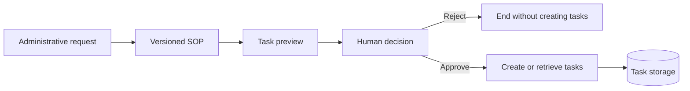

# CareOps Agent | From an SOP to human-reviewed tasks

An administrative onboarding request starts with a fictional standard operating procedure. CareOps retrieves its versioned instructions, previews three tasks and asks a person to approve them before writing. Repeating an approval should return the existing tasks. This prototype uses synthetic administrative data.

[Follow the approval walkthrough](walkthrough.md). The deployed interface requires owner authentication.

### Why the storage boundary matters

A preview gives a reviewer something concrete to approve. A text reply alone cannot establish that any task was saved. The decision is applied at the storage boundary, where a repeated approval can return the previously accepted tasks. The project includes SQLite and an explicitly selected Firestore adapter.

### Engineering evidence

The retained 31 October 2026 summary (`47d4570`, `PUBLIC_STATUS.md`) documents rejection, creation after approval, and repeated approval for bounded cases. One fresh session recalled a Japanese response preference. Exhaustive concurrency, expiry and restart coverage remains open.

| Frozen Lab 4 evaluation | Recorded outcome |
| --- | --- |
| Baseline | 3 passed, 0 failed |
| Deliberately regressed checklist | 0 passed, 1 failed |
| Restored checklist case | 1 passed, 0 failed |

Only the affected case was rerun after restoration. The source checkpoint and deployed diagnostic version differ. Model Armor matched the operator control, while the attached runtime returned HTTP 401 on both transports. Runtime detection remains unverified.

The project uses Google ADK and Gemini. Several original repository files carry Google LLC Apache 2.0 notices. This showcase contains original explanatory material and an illustrative walkthrough.
