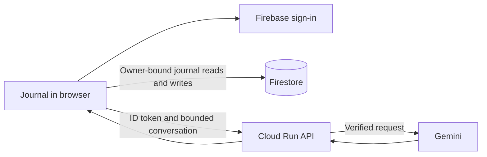

# Reflect AI | A journal that can recover from a failed turn

A bilingual journal pairs a user's writing with a Gemini response. Two operations can fail independently: generating a reply and saving it. I designed the conversation flow to persist the user's message first and report completion only after the final write succeeds. A reload can then recover the original entry.

[Watch the product walkthrough](https://lnkd.in/p/g2PDpeEi) · [Open the journal](https://reflective-journal-ai-companion.ai.studio/)

### Engineering decisions

- The starter exercise provides the sign-in, journaling and storage concept. Project-specific work included validating message-history transitions, recovering a partially saved turn, and handling temporary model errors.
- Location is optional. A user chooses and saves a pin explicitly. The conversation sent to Gemini omits the coordinates.
- A shared browser origin does not establish journal ownership. Firestore rules bind each entry to a signed-in user, while the server separately verifies identity for generation.

### Evidence

The submission checkpoint (`7a5ef99`, September 2026) records 31 of 31 Firestore Emulator rule tests, 13 of 13 security tests and 5 of 5 location tests passing. User-operated submission-day checks covered a first message, reply and reload. Those historical checks concern the submitted version. App Check enforcement was documented as monitoring only.

The walkthrough uses synthetic journal content. This project supports personal reflection. [Google Cloud starter codelab](https://codelabs.developers.google.com/codelabs/cloud-run/cloud-run-ai-challenge)
