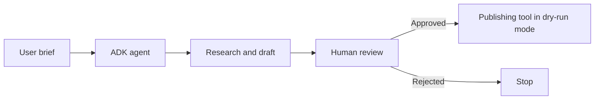

# Social Spark | Reviewing a draft before an external action

Social Spark is the reference application for GDG London's Agentic DevCamp. The course provides the agent, research and drafting workflow, publishing integrations and approval concept. My lab branches recorded session and memory experiments, an anonymized event set, and work on governance controls. The distinction matters when interpreting a successful demo.

### What the lab records show

The Lab 2 checkpoint (`bbb349e`) documents three sessions with 20, 20 and 6 events, plus five synthetic memory records. Two sessions show approval followed by simulated posting. Their memory searches returned empty results. The manifest digests for the anonymized data and its README were rechecked against the stored Git files on 21 November 2026.

### Try a technical sample

[Open the Python demo](review_trace.py). From this folder, run `python review_trace.py` with Python 3.10 or later. It checks a small synthetic event history. Compare approval of revision 1 with an attempted simulated publish of revision 2. The check ties approval to a specific draft revision. A later rejection invalidates the approval.

This standalone sample was written for the portfolio. It uses only the Python standard library. The original agent, course diagrams, branding and event payloads are outside this sample. [Course repository](https://github.com/sonikajanagill/ai-devcamp-labs)

On 21 November 2026 all five offline examples produced the expected outcome. Only the reviewed revision was accepted. The other four cases exercised missing, stale, withdrawn and reused approvals. This run covered the standalone sample.
